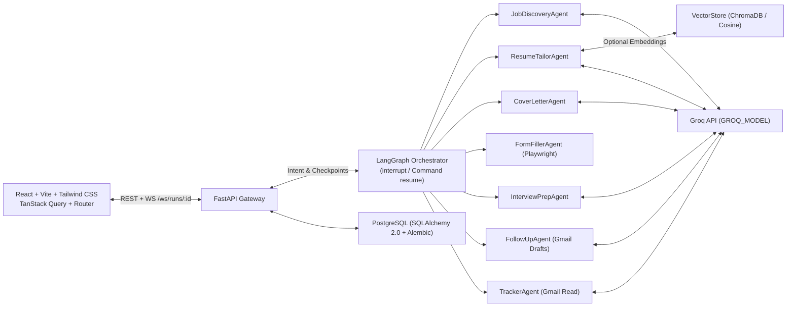

# Job Application Copilot

A production-quality, human-in-the-loop multi-agent system that helps a job seeker discover jobs, tailor resumes truthfully, write cover letters, pre-fill application forms safely, prepare for interviews, draft follow-up emails, and track application status.

## Core Principles

1. **Human-in-the-loop**: Never auto-submit applications and never auto-send emails. The Playwright form filler always stops on the review step with screenshots; follow-up emails are saved as Gmail drafts only after explicit user approval.
2. **Resume truthfulness**: `ResumeTailorAgent` only reorders, emphasizes, and rephrases verified experience from the master resume and profile. Unmatched JD keywords are surfaced under `missing_keywords` rather than fabricated.
3. **Respect site terms**: Job discovery uses public APIs/RSS feeds (Remotive, Arbeitnow, RSS, or user-pasted URLs). Login gates and CAPTCHAs are never bypassed.
4. **Full observability**: Every agent execution logs `agent_name`, `input_summary`, `output_summary`, `status`, `latency_ms`, `tokens_used`, and `error` to PostgreSQL and streams live events via WebSocket.
5. **Secrets via environment variables**: All API keys and OAuth client secrets are read from `.env` (never hardcoded), and Gmail OAuth tokens are encrypted at rest with Fernet.

## Architecture



## Tech Stack

- **Frontend**: React 18, TypeScript, Vite, Tailwind CSS, React Router, TanStack Query, Lucide Icons
- **Backend**: Python 3.11+, FastAPI, SQLAlchemy 2.0, Alembic, Pydantic v2
- **Database**: PostgreSQL 16 (Docker), optional ChromaDB vector store
- **Orchestration & AI**: LangGraph (checkpointed state graph + `interrupt()`), Groq API (`GROQ_MODEL`, default `llama-3.3-70b-versatile`)
- **Automation & Email**: Playwright (Chromium), Google Gmail API OAuth2 (`gmail.readonly` + `gmail.compose` only)

## Project Structure

```text
├── backend/
│   ├── alembic/versions/        # Migrations (0001..0003)
│   ├── app/
│   │   ├── agents/              # 7 specialized agents + base telemetry + prompts/
│   │   ├── api/                 # REST & WebSocket routers (/api/*, /ws/runs/{id})
│   │   ├── core/                # config, db, security (Fernet + HMAC), logging
│   │   ├── graph/               # LangGraph state & orchestrator with HITL interrupt
│   │   ├── models/              # SQLAlchemy 2.0 ORM models
│   │   ├── schemas/             # Pydantic v2 API & LLM validation schemas
│   │   └── services/            # groq, gmail, playwright, resume_parser, vector_store, ws_manager
│   ├── scripts/
│   │   └── evaluate.py          # Real-time DB metrics reporter (latency, coverage, success rate)
│   └── tests/                   # Pytest unit, API, mocked-Groq, WS, and Playwright tests
├── frontend/src/
│   ├── api/                     # Typed REST & WebSocket client
│   ├── components/              # Responsive Layout (light/dark mode) & PageHeader
│   ├── hooks/                   # Theme hook
│   ├── pages/                   # Dashboard, Profile, Jobs, Applications, Workspace, Agent Monitor, Settings
│   └── types/                   # Shared TypeScript interfaces
├── docker-compose.yml
└── .env.example
```

## Setup & Running

### Option A: Docker Compose (Recommended)

1. Copy environment template and add your keys (optional for offline/deterministic demo mode):
   ```bash
   cp .env.example .env
   ```
2. Start PostgreSQL, FastAPI backend (auto-runs `alembic upgrade head`), and React frontend:
   ```bash
   docker compose up --build
   ```
3. Open the app:
   - Frontend UI: http://localhost:5173
   - Backend API Docs: http://localhost:8000/docs
   - Health Check: http://localhost:8000/api/health

### Option B: Local Development

```bash
# Backend
cd backend
python -m venv .venv
# Windows: .\.venv\Scripts\activate  |  macOS/Linux: source .venv/bin/activate
pip install -r requirements.txt
playwright install chromium
alembic upgrade head
uvicorn app.main:app --reload --port 8000

# Frontend (new terminal)
cd frontend
npm install
npm run dev
```

## Tests & Evaluation

```bash
# Run full backend test suite (includes mocked-Groq agent tests, WebSocket, and Playwright mock form)
cd backend
pytest -v

# Report real-time metrics from the live database (avg tailoring time, keyword coverage, agent success rate)
python -m scripts.evaluate

# Build & type-check frontend
cd ../frontend
npm run build
```


Terminal 1 — Backend (FastAPI + LangGraph + Playwright):

cd "e:\Aadhi\Multi-Agent Job Application Copilot\backend"
$env:DATABASE_URL="sqlite:///./job_copilot.db"
.\.venv\Scripts\python -m uvicorn app.main:app --reload --port 8000


Terminal 2 — Frontend (React + Vite):

cd "e:\Aadhi\Multi-Agent Job Application Copilot\frontend"
npm run dev